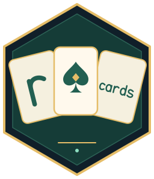
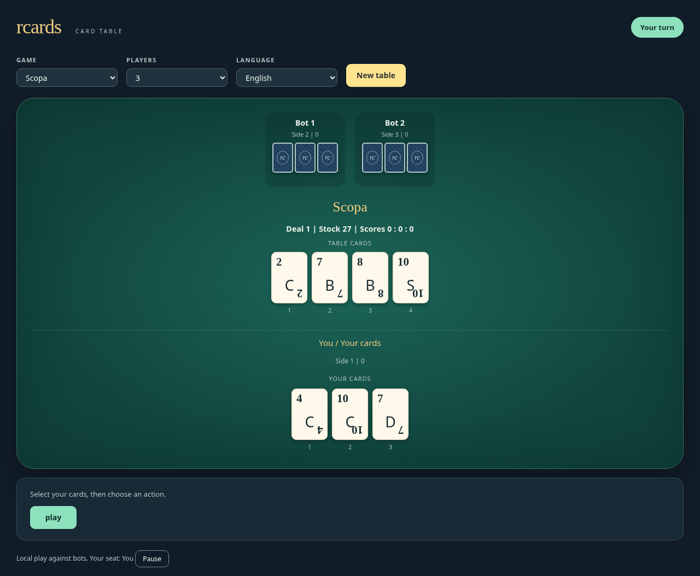

<p align="center">
  
</p>

# rcards

**Play, simulate, and explore card games in R.**

Take a seat at a card table, build a bot, or ask how likely a hand is to win.
`rcards` brings five games, console and browser play, and statistical tools
into one R package.

[Start playing](#start-playing) · [Games](#supported-games) ·
[Statistics](#probabilities-and-simulations) · [Documentation](#documentation)

<p align="center">
  
</p>

*A local Scopa table: your cards, public information, and a choice of legal moves.*

## Start playing

The package is under development. Clone this repository, open an R session
in its root, and load the current source:

```r
install.packages(c("pkgload", "testthat", "shiny"))  # once; omit shiny for console-only play
pkgload::load_all(".")
rcards::play_app()
```

Choose a game, player count, and language, then click **New table**. You play
one seat against bots; Blackjack pits you against the dealer. Select cards
when the game calls for them and use the legal action buttons. Poker raises
are labeled as the **total for the current betting round**. **Next hand**
continues poker with settled stacks and a rotated dealer; Mus and Scopa also
offer it while the match continues. Poker stops when you run out of chips or
fewer than two funded players remain; **New table** explicitly starts over.
Blackjack offers **Next round** with your settled bankroll and a visible wager
choice. Each Blackjack round uses a freshly shuffled shoe.

The graphical app runs locally in your browser and keeps each session in
memory. See [graphical play](docs/graphical-interface.md) for configured games,
controls, and session limits.

### Prefer the console?

With `pkgload` and `testthat` installed, load the checkout with
`pkgload::load_all(".")`; Shiny is not needed. This starts one Blackjack round
with Italian prompts:

```r
rcards::play(
  rcards::blackjack_game(list(rcards::player("You", points = 100))),
  list(rcards::console_player(language = "it"))
)
```

Console play shows your cards, public information, and legal moves. Enter an
action name or menu number, or `q` to stop. Human, bot, and scripted controllers
use the same game engines. See [console play](docs/console-play.md) for poker,
Mus, Scopa, Mentiroso, and resuming a stopped game.

## Supported games

| Game | Players | What you can play |
| --- | --- | --- |
| [Texas Hold'em](docs/rules/holdem.md) | 2–10 | No-limit hands with blinds, all-ins, side pots, and split pots; continue with the same stacks. |
| [Mus](docs/rules/mus.md) | 4, in partnerships | Configurable four/eight kings and a 30/40-point target, with exchanges and lance wagering. |
| [Blackjack](docs/rules/blackjack.md) | 1–7 versus the dealer | Continue rounds with your bankroll, configurable dealer rules, doubles, and splits. The default graphical table has one player. |
| [Scopa](docs/rules/scopa.md) | 2–4 | Two or three individual players, or four in partnerships; choose captures and play matches. |
| [Mentiroso / Liar](docs/rules/liar.md) | 2–8 | Face-down claims, bluffing, and challenges; the declared rank stays fixed until a challenge. |

Play and card displays support **English, Spanish, German, and Italian**
(`en`, `es`, `de`, `it`). Translations preserve canonical card identities and
game state. Baseline bots are provided for every game; they use public
observations and are not optimal strategies.

## Probabilities and simulations

Start with a question about a hand. For example, estimate the showdown equity
of suited ace–king against one uniformly random opponent:

```r
hole <- list(rcards::card("A", "Spades"),
             rcards::card("K", "Spades"))
equity <- rcards::poker_equity(hole, n = 1000, seed = 42)
equity$estimates
```

Equity is the expected share of the pot at showdown, including ties. This
model does not simulate betting or folding. Reports include their assumptions
and sampling uncertainty; more samples reduce sampling noise.

For known outs, use exact counting instead of simulation:

```r
rcards::draw_probability(successes = 9, remaining = 47, draws = 1)
# 9 / 47: the chance of hitting one of nine outs on the next card
```

`estimate_hand()` also estimates Mus lance strength; `estimate_actions()`
compares Blackjack or Scopa decisions under continuation strategies.
`simulate_games()` runs repeated hands or matches with score/profit summaries.
These calculations run locally without external APIs or ranking datasets.
See [statistical methods and budgets](docs/statistics.md) for assumptions,
cost controls, and examples.

## Quick start

Build and deal a deck through the foundation API:

```r
set.seed(42)
utils::data("deck_french", package = "rcards", envir = environment())
pack <- rcards::deck(cards = attr(deck_french, "main_cards"))
pack <- rcards::shuffle(pack)
alice <- rcards::player(name = "Alice")

dealt <- rcards::take_cards(alice, pack, n = 5)
stopifnot(length(dealt$player$hand) == 5L, length(dealt$deck) == 47L)

# Return two cards to the bottom of the remaining deck.
returned <- rcards::leave_cards(dealt$player, dealt$deck, c(1, 2))
stopifnot(length(returned$player$hand) == 3L, length(returned$deck) == 49L)
print(returned$player)
print(returned$deck)
```

The foundation includes `card()`, `deck()`, `player()`, `table()`, `game()`,
`shuffle()`, and the card-transfer functions above. Operations return updated
objects rather than modifying their inputs. `deck()` starts empty; construct
a game-specific pack explicitly. When the package is attached, `table()` masks
`base::table()`; qualify either function name when needed.

French and Spanish datasets contain explicit main and optional card lists;
their generators use `usethis::use_data()`. The French main pack has 52 cards
with two optional jokers; the Spanish main pack has 40 cards with optional
8s and 9s. `italian_deck()` constructs a 40-card Italian pack directly.

## Documentation

| Explore | Read |
| --- | --- |
| Play interactively | [Graphical table](docs/graphical-interface.md) · [Console guide](docs/console-play.md) |
| Learn the engines and bots | [Games and examples](docs/games.md) · [Supported rule profiles](docs/rules/audit.md) |
| Estimate and simulate | [Statistical methods](docs/statistics.md) |
| Extend the package | [Contributing](CONTRIBUTING.md) · [Game development guide](AGENTS.md) |
| Reuse the artwork | [Asset provenance and license](docs/branding.md) |

Use R help, such as `?rcards::play_app` or `?rcards::poker_equity`, for function
arguments. Runnable examples are installed under `examples/`, including
`graphical-play.R`, `holdem.R`, `mus.R`, and `statistics.R`.

## Development and validation

```r
install.packages("testthat")  # once
testthat::test_local()
```

Build and check from the parent directory:

```sh
R CMD build rcards
R CMD check --no-manual rcards_0.0.0.9000.tar.gz
```

See [CONTRIBUTING.md](CONTRIBUTING.md) and the
[Code of Conduct](CODE_OF_CONDUCT.md) before contributing.
The package and original repository artwork use the [Apache 2.0 license](LICENSE).
